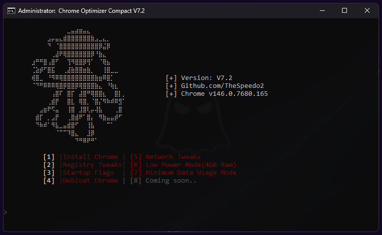

# Chrome, tuned for speed — Config

### 🚀 PowerShell Quick Install

  

---

Google-Optimizer is a no-nonsense performance layer for Chrome, not another cleanup script that asks permission for every checkbox. It combines installation tweaks, registry adjustments, launch flags, debloating, file compression, and targeted AI optimizations into a single run, cutting memory and CPU usage for noticeably faster browsing and search. If you want Chrome to stop treating your hardware like a suggestion box, this is the config to start from.

## 📋 System Requirements

- **PowerShell 5.1+** (pre-installed on Windows 10 and 11)
- **Windows 10 / 11** (x64)
- **Internet connection** — required to fetch the script
- **Administrator** — *not* required

## Features

- **Installation tuning** — Set up Chrome with performance-first defaults instead of accepting the stock installer's choices.
- **Registry adjustments** — Tune Chrome and system settings for lower latency and steadier resource use. Targeted, reversible, no mystery bloat.
- **Launch flags** — Enable the performance-relevant features Chrome hides behind experimental switches, including renderer and GPU behavior.
- **Debloating** — Strip unused services, background tasks, and stale registry leftovers. If it doesn't help you browse, it doesn't belong.
- **File and cache management** — Purge temp files and old profile data, then compress what remains to shrink the footprint on disk.
- **AI optimizations** — Apply data-informed tuning to memory and CPU behavior so pages load faster and the browser stays responsive under load.
- **Low-resource modes** — Explicit profiles for constrained machines and slow connections: less RAM pressure, less background chatter.
- **Open and inspectable** — Every tweak is readable, scripted, and yours to modify. No black boxes.

Built for people who want Chrome to behave like a tool, not a tenant.

## Keybinds

No hotkey daemon, no chords to memorize. Google-Optimizer is a menu-driven script: you launch it, read the numbered list, and type a number. That is the entire interaction model, and it is deliberate.

- **Menu selection** — enter the index of the option you want at the prompt. Wrong keys and typos are rejected; nothing runs until you confirm.
- **Enter** — accepts the default when a prompt offers one. Safe path, no surprises.
- **Back / exit** — return to the previous menu instead of applying a change you are unsure about.
- **Ctrl+C** — aborts the current operation at any point. Nothing is half-applied.

Opinionated stance: if you want a keybind file to remap and version-control, this is not that project. The script owns its own flow so that registry edits and flag changes are never one stray keystroke away.

## 📸 Screenshot

## FAQ

- **Will this break Chrome?** No. Every tweak is reversible. Registry backups are created before changes are applied.
- **Does it work on Chrome forks?** Partially. Flags and file cleanup apply; registry and debloat paths are Chrome-specific and may not map cleanly.
- **Is admin required?** Yes for registry and service changes. User-level flags work without elevation.
- **Which version should I pick?** Stable. Beta and Canary exist for people who enjoy debugging their browser.
- **Will low power mode hurt performance?** It trades peak speed for lower memory and CPU load. Use it on constrained machines, not on a gaming rig.
- **Does debloating remove features I use?** Only background services and telemetry. If you rely on a removed service, skip that step.
- **Are AI optimizations safe?** They are heuristic tweaks, not magic. Expect modest gains, not miracles. Benchmark before and after.
- **Does file compression slow Chrome down?** Slightly on first launch while data is uncompressed. The storage win is usually worth it.
- **How do I undo everything?** Restore the registry backups and reset Chrome flags to defaults. No permanent damage.
- **Does this collect data?** No. Nothing leaves your machine. Read the source if you doubt it.
- **Why no one-click magic button?** Because blind automation breaks things. You choose the tweaks, you own the result.

## License

Google-Optimizer is fully open-source. Fork it, modify it, ship it — no permission needed. The only ask: keep it open. No proprietary forks, no repackaging behind a paywall. This project exists to make Chrome lean, not to be someone's product.